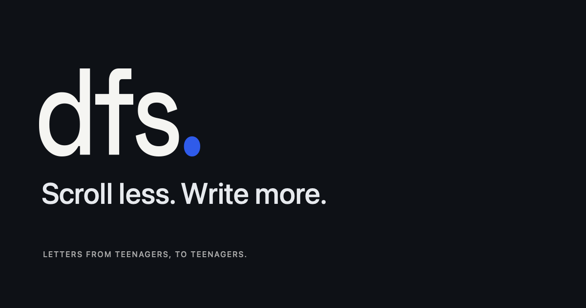

# Dear Fellow Scroller

An open-source website for a teen-written newsletter about spending less time scrolling. A simulated feed slows down as you scroll, dissolving into a letter and an invitation to write.

**Built with:** semantic HTML, modern CSS, vanilla JavaScript, self-hosted fonts, and Netlify Forms. No build step or runtime dependencies.

**Project status:** source published and deployed to Netlify. Public visitor access and form delivery verification are pending. See the verification notes below for tested behavior and remaining checks.

**Deployment:** https://dear-fellow-scroller.netlify.app

## License and attribution

The website code is available under the [MIT License](LICENSE). Bundled fonts retain their separate SIL Open Font Licenses in `fonts/*-OFL.txt`. Dear Fellow Scroller logos and editorial content are excluded from the code license; replace them when reusing the site for another project. Implementation was developed with AI assistance.

A buildless, static newsletter site. HTML, CSS and vanilla JavaScript; no runtime dependencies, analytics, cookies, storage, or external scripts. Author: Dear Fellow Scroller.

## Preview

From this folder run `python3 -m http.server 8000`, then visit `http://localhost:8000`. No installation or internet access is needed. Stop with Control-C.

Opening `index.html` directly displays all core content and native form fallbacks. Browsers restrict ES modules on `file://`, so use the local server to preview the intro, config updates, and enhanced forms. A form submission requires Netlify; the local preview does not store or email anything.

## Fonts

The following Latin WOFF2 fonts are installed locally (no CDN requests at runtime):

- `fonts/space-grotesk-400.woff2`
- `fonts/space-grotesk-500.woff2`
- `fonts/inter-400.woff2`
- `fonts/inter-500.woff2`
- `fonts/instrument-serif-400.woff2`
- `fonts/instrument-serif-400-italic.woff2`

The font-face URLs in `css/tokens.css` point to these local files. Inter and Space Grotesk use variable font files supporting both requested weights; each is provided under the two filenames already expected by the stylesheet. The three accompanying `*-OFL.txt` files retain the fonts’ original copyright and SIL Open Font License notices. These third-party attribution notices are required and are distinct from the website author identity. System sans-serif/Georgia fallbacks remain available. Fonts were obtained from Google Fonts and licenses from the official google/fonts repository.

## Edit content

`js/config.js` exports `SITE`, the source for enhanced page content. Set `writersJoined: 4` to update both counters, the thin progress bar and the segmented bar. `writersGoal` controls their denominator and the recruitment headline. Submissions never change these values automatically.

Edit the letter title, subtitle, date, destination, publication and social URLs here too. The optional video is hidden until `youtubeLatestVideoId` contains a valid 11-character ID. Its local play facade makes no thumbnail request; a privacy-enhanced YouTube iframe loads only on click. YouTube then receives the visitor’s connection and may make additional requests.

Static HTML contains sensible no-JavaScript defaults. When changing permanent content, also update the matching fallbacks in `index.html`, `links/index.html` and `joined/index.html` so no-JS visitors and search crawlers get the new values. Owner-editable prose is marked in HTML comments. No personal email address is exposed in the site; subscribe email comes only from the visitor’s form input.

Replace `https://example.com` with the final HTTPS domain in the canonical and social-image tags, Organization JSON-LD, config, `robots.txt` and `sitemap.xml`. Social images must have absolute URLs. The supplied brand logos are retained in `assets/`; PNG icons and the 1200×630 share card are generated locally from them.

## Deploy to Netlify from GitHub

1. Use a brand GitHub account and brand email. Create a repository and upload this folder’s contents. The top level must contain `index.html` and `netlify.toml`.
2. In Netlify, choose Add new project / Import an existing project, choose GitHub, and select the repository.
3. Leave the build command blank. Set the publish directory to `.` (the repository root). Deploy. No package install or build is required.
4. Open the site’s Forms page and enable form detection. If enabled after the first deploy, trigger another deploy so Netlify scans the static HTML.
5. Check that Forms lists `founding-writers`. It has two visible fields plus hidden form identification and a bot honeypot. There is no reCAPTCHA.
6. Under Site settings (or Project configuration) → Forms → Form notifications, add an email notification for `founding-writers`, addressed to the owner’s brand Netlify account email. Email notifications need to be explicitly configured; do not assume they are automatic.
7. Submit a test using a brand nickname and an email you control. Confirm the success message, stored submission, and email notification. Also test with JavaScript disabled: it should reach `/joined/`.
8. View submissions under Forms → founding-writers. Select a submission and use Delete to remove it. Also delete related notification emails when honoring a deletion request.
9. Reply by hand from the brand email with a welcome and first writing prompt within 48 hours. Netlify does not automatically send that welcome. The public writer count changes only when the owner edits config after confirming a writer.

Submission data is processed by Netlify and, when notifications are enabled, the email provider. The site does not send it to analytics or marketing services. Protect access to the Netlify account and mailbox; the privacy promise depends on who has access and on honoring deletion requests.

## Custom domain

In Netlify’s Domain management, add your domain (for example `dearfellowscroller.com`). Follow the displayed DNS instructions at your registrar, wait for verification, and enable/verify HTTPS. Set one primary domain and redirect any alternate domain to it. Enable WHOIS privacy at the registrar. Update the placeholder URLs above after choosing the domain.

## Anonymity checklist

- Use the brand GitHub account and brand email, including for Netlify notifications and replies.
- Before the first commit, set `git config user.name "Dear Fellow Scroller"` and `git config user.email "YOUR_BRAND_EMAIL"` locally in the repository. Substitute the actual brand email; do not commit the placeholder.
- Review commit history, image metadata and repository files before publishing. Avoid personal names, personal paths, account screenshots and personal contact details.
- Keep Netlify and mailbox access restricted to the founder and enable account security protections.
- Do not add analytics, pixels, embeds on page load, remote fonts or CAPTCHA.
- Publish writing only with explicit permission; delete submission records and associated emails when asked.

## Motion and accessibility

The decorative intro has 16 reused cards, cached geometry, and one requestAnimationFrame scheduler. The hook advances while idle; subsequent feed position is a deterministic function of scroll. The typing caret also animates while its phase is visible. Observers pause work off-screen and when the page is hidden. Reduced motion uses a static desaturated composition, without the tall scrolling intro. The first focusable link skips to the hero.

The mobile menu supports Escape and wraps keyboard focus. Forms have labels, inline errors, disabled sending state and accessible confirmation focus. The join form retains values on failure and times out after 20 seconds. No personal data is saved in browser storage.

## Verification and launch checks

JavaScript can be checked without dependencies: `node --input-type=module --check < js/main.js` (repeat for config and intro).

Before launch, verify on Netlify at 360, 390, 768, 1024, 1440 and 1920 pixels; keyboard-only navigation; reduced motion; reverse intro scroll; config counter updates; subscribe redirect; join success/error/native submission; and Network requests with cache disabled. Initial requests must all be same-origin. The optional video may connect externally only after its button is pressed.

Run a mobile Lighthouse audit after fonts and final domain are installed. A score of 95+ and sustained 55–60 fps are targets, not measured claims. Test at a throttled mobile CPU profile. Netlify form delivery and notification emails cannot be verified from the local folder.

## Local verification recorded

- JavaScript syntax checks passed for all three modules.
- Browser DOM measurements found no horizontal overflow at 360, 390, 768, 1024, 1440 and 1920 CSS pixels.
- Browser confirmed 16 feed cards, empty-field validation, and a failed local POST retaining typed values and re-enabling submission.
- Both supporting pages rendered with their intended links and confirmation content.
- Generated PNG dimensions verified: 32×32, 180×180 and 1200×630; share card visually inspected.
- All six local WOFF2 font files are installed, with valid binary headers and the three accompanying OFL license notices.
- Success delivery, reduced-motion emulation, complete keyboard traversal, network-panel audit, Lighthouse and throttled frame-rate measurements remain launch checks.
